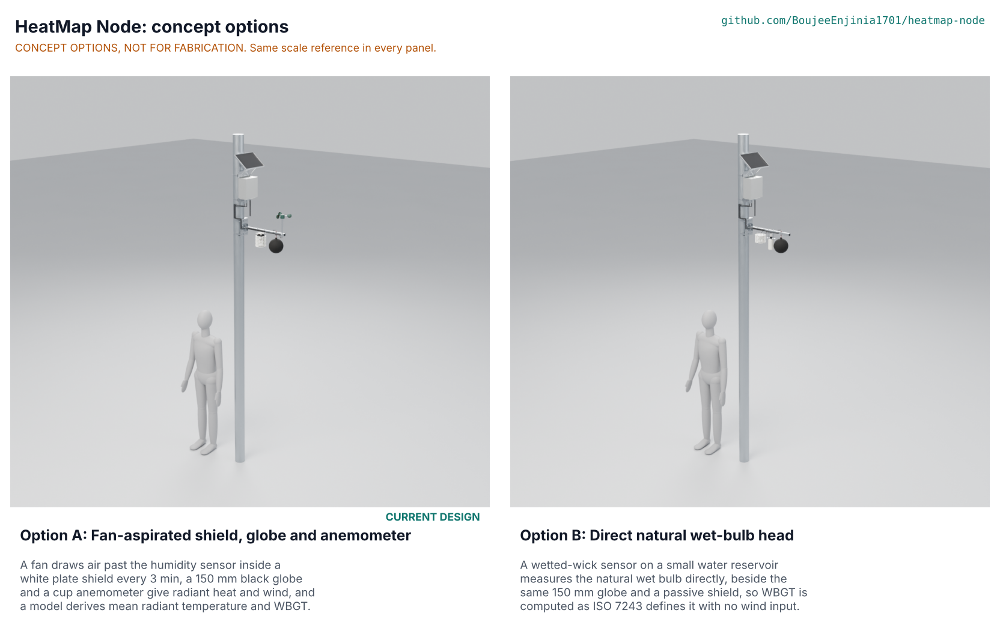

# HeatMap Node concept options

Result: option A, the fan-aspirated shield with a globe and anemometer (the current design), scored 140 of 180 and option B, the direct natural wet-bulb head, 129. The difference is 7.9 %, within the 10 % band, so **both options go to Amish without a pick: Proposed, awaiting Amish** (HMN-DDR-004, HMN-DEC-001). The lean, if he wants one, is option A: it measures wind and keeps the sensor head free of water, but B is cheaper and measures the wet bulb that ISO 7243 names, so B's best idea is worth grafting if A's derived WBGT fails its comparison. Both options are modelled to detail level D3 in `cad/src/model.py` ("Detail every option", Amish, 2026-10-24); the picture below is rendered from those models by the coordinator (`media/options.png`, not yet made). Method: STANDARDS section 21. Product requirement PR-017 (buildable from open files) is met for both models.

## The options

### Option A: fan-aspirated shield, globe and anemometer

Eight white plates on four rods shade an SHT45 air temperature and humidity sensor, a 60 mm fan draws 4.0 L/s of air through them for 6 s before each reading, a 150 mm black copper globe with a thermistor reads radiant heat, a cup anemometer reads wind, and the WBGT is computed on the server by the Liljegren method (HMN-CAL-001). A formed aluminium saddle and two strap bands hold a 530 mm arm to a 60 to 200 mm pole; the FieldNode core sits above the arm. Risks: the derived WBGT depends on a model whose error is not known for streets (PR-005 at risk), the fan and anemometer bearings wear, and the sensors sit at 2.7 m (PR-009). Needs from a partner: a pole owner, a collocation site with a reference WBGT meter.

### Option B: direct natural wet-bulb head

The same saddle, arm, globe and a passive six-plate shield, with no fan and no anemometer. In place of them, a wetted cotton wick on a sensor sleeve is fed from a 56 mm HDPE bottle on a plate below the arm, and the NTC thermistor on the wick reads the natural wet-bulb temperature directly; WBGT is the weighted sum of the three directly measured values (0.7 wet bulb, 0.2 globe, 0.1 air), the definition of ISO 7243. Wind is not measured, so the Liljegren model and the wind channel are dropped. Risks: the bottle must be refilled with distilled water every 5 to 7 days (K1b), the water freezes below 0 C (K1: 85 % fill line and a flag), and a dusty wick under-reads. Needs from a partner: someone to refill and check wicks, a source of distilled water.

## First-order numbers

Table 1. Options compared (D3 figures from `cad/fidelity.json`; costs from `bom/bom.csv`).

| Quantity | Option A | Option B |
| --- | --- | --- |
| Estimated parts cost of the sensor head (USD) | 136.00 (priced BOM, USD 6 over the 130 target) | About 101 (estimate from A's BOM lines: no fan, no anemometer, six plates, a bottle, a wick and plate added) |
| Mass of the D3 model (kg) | 4.3 | 4.2 |
| Parts in the D3 model (with fasteners) | 130 (63 fasteners) | 123 (59 fasteners) |
| Average electrical load of the head (mW) | 35.4 | About 0.1 (sensors only, estimate) |
| WBGT method | Computed (Liljegren), input error 0.30 C RSS | Measured, error 0.37 C assumed (S37) |
| Visit interval | About 6 months (PR-018 proposal) | 5 days in hot dry spells, 7 days otherwise (K1b) |
| Moving parts | 2 (fan, cup rotor) | 0 |
| STEM check | Within known science; plausible rows S6, S7, S11 | Within known science in principle; two details fixed (K1, K1b), plausible rows S31b, S33, S34b, S35 to S37 |

## Scoring

Table 2. Weighted scoring (weights: High UR 3, Medium 2, Low 1; scores 1 to 5; maximum 180).

| Criterion | Source | Weight | A | B | Reason |
| --- | --- | --- | --- | --- | --- |
| Street-level heat stress | UR-001 | 3 | 5 | 3 | A reports WBGT, MRT, air, humidity and wind; B gives WBGT, air and humidity but no wind and no MRT |
| Numbers I can trust | UR-002 | 3 | 3 | 4 | B measures the natural wet bulb that ISO 7243 names; A derives it (Liljegren model error unknown, PR-005 at risk); B's wick state adds its own error |
| Fits the poles we have | UR-003 | 3 | 4 | 4 | Same saddle, bands and arm |
| Quick to fit | UR-004 | 2 | 4 | 4 | Same fitting; B adds filling the bottle on site |
| Runs without mains | UR-005 | 3 | 4 | 5 | A's fan averages 35 mW of a 100 mW allowance; B has none |
| Near-real-time data | UR-006 | 3 | 4 | 4 | Same FieldNode payload |
| Cheap enough for a network | UR-007 | 3 | 3 | 4 | A USD 136 priced (USD 6 over the target); B about USD 101 estimated |
| Survives the street | UR-008 | 3 | 4 | 2 | B's reservoir freezes below 0 C (fix K1 flags the channel invalid) and its wick fouls in dust |
| Environmental data only | UR-009 | 3 | 5 | 5 | Neither has a camera, microphone or radio scan |
| Open, documented data | UR-010 | 2 | 4 | 4 | Same payload and calibration record; B's wick state to be logged |
| Little upkeep | UR-011 | 2 | 4 | 1 | A: a visit about every 6 months; B: water every 5 to 7 days (K1b) plus wick changes |
| Safe overhead | UR-012 | 2 | 4 | 4 | Both 4.2 to 4.3 kg in the model; B adds 0.1 kg of water |
| Measured where people walk | UR-013 | 2 | 2 | 2 | Both at 2.67 to 2.8 m (PR-009 not met) |
| Buildable by a community | UR-014 | 2 | 4 | 3 | B needs a wick, a bottle with a gland and distilled water |
| **Weighted total** | | | **140** | **129** | |

Weighted total = sum of score x weight over the 14 user requirements. The two totals differ by 11 points, 7.9 % of the larger.

## Recommendation

**Proposed, awaiting Amish.** The two options are within 10 %, so no pick is made: both go to Amish (argued in HMN-DDR-004). If a lean is wanted, it is **option A**, because it is the current design with a priced BOM, a drawing and a build plan, it measures wind (which the map users asked for), and its weaknesses (derived WBGT, fan flow) can be tested on a collocated pole at TRL 4, while B's weaknesses (water, freezing, fouling) are recurring costs at every node. Option B's best idea to graft onto A is the **direct natural wet-bulb reading** as a reference node: one B-type head collocated beside every ten A nodes would give the field data that tests the Liljegren model without a mains reference meter. That grafting is a proposal for Amish and changes no number in the current design.
